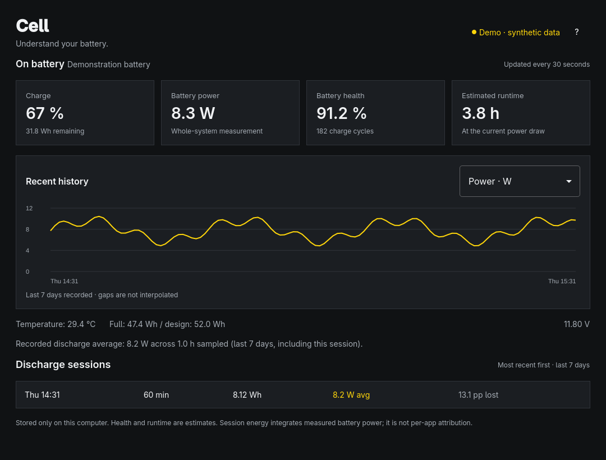

# Cell

Battery insights in the Omarchy bar, backed by a local C++ collector. The
optional Qt Quick desktop companion remains available. The plugin uses Omarchy's
own bar button, keyboard panel, palette, typography and motion.

## Marketplace installation (release candidate)

Early release: tested on Omarchy 4.5 and one ARM/Asahi laptop. Other hardware
and Omarchy versions need testing. Requires Qt 6 development tools (`qt6-base`,
`qt6-declarative`), a C++ compiler, `make`, and `nodejs` for the optional tests.

```sh
omarchy plugin add https://github.com/nameetrajore/omarchy-cell.git  # Build before enabling
cd ~/.config/omarchy/plugins/nameetrajore.cell
bin/build
omarchy plugin enable nameetrajore.cell
```

Enabling replaces the built-in power widget via Omarchy's clone routing. If you
already use a customized power widget, disable that clone first; Omarchy does not
automatically replace another clone, so otherwise both icons remain. The background
collector is **opt-in**: run `bin/record enable` from this checkout. It starts at
login, samples every 30 seconds, and records locally until stopped. No network
access is used. Review the privacy details below before enabling it.

To remove it, first run `bin/record disable` if recording was enabled; remove
`~/.config/systemd/user/cell.service` and run `systemctl --user daemon-reload`.
Then run `omarchy plugin remove nameetrajore.cell` and enable `omarchy.power`
if it is not restored automatically. History is deliberately retained at
`~/.local/share/cell/cell/`; remove that directory yourself only if desired.
After plugin updates run `bin/build` again and, if recording is enabled, restart
`cell.service`. Never remove the plugin directory while its collector is running.

The integrated panel derives from Omarchy's power panel; see `OMARCHY-LICENSE`.
Cell is substantially AI-authored and has not received independent human review.

## Development installation

```sh
bin/build
bin/test
bin/test-plugin
bin/test-power
bin/integrate-power
```

The integration command uses Omarchy's official clone mechanism for the existing
battery widget (`<username>.power`). It preserves charge information and profile
controls, adds compact Overview / Compare / History tabs **below them**, and
disables the separate Cell icon. Packaged Omarchy files are never edited. Existing
custom clones are not overwritten unless they were created by this integration.
Backups live under `~/.local/state/cell/backups`. The shell restarts to clear stale
QML; if locked, unlock before restarting it with `omarchy restart shell`.

Open your normal battery icon. `1`–`3` or Left/Right selects an insights tab;
Up/Down selects a power profile, Enter/Space activates it when selected, and `R`
refreshes. Overview toggles power/charge and 15/60-minute ranges; hover to inspect,
click to pin a sample. History switches W/Wh and selects sessions. The `?` tooltip
holds method details. No scrolling or duplicate charge/runtime blocks.

`bin/install-plugin` remains an optional standalone installation. To restore the
stock battery widget, enable `omarchy.power` through Omarchy's plugin controls.
Neither UI removal stops collection; `bin/record disable` does that.

The plugin ships English with Omarchy language fallback. The desktop companion
also ships Danish. Neither changes desktop settings or power profiles.

### Comparisons and clues

New samples record whole-system CPU utilization, built-in backlight percentage,
power profile, connected display identifiers, and up to five busiest process
names owned by your user. CPU shares are normalized to total machine capacity.
First samples, missing sensors and sleep gaps remain unknown. Existing battery
history is preserved, but missing historical context is never reconstructed.

Comparisons use complete, non-overlapping five-minute discharge windows. The
latest complete window is matched against windows from **earlier discharge
sessions**, never its own session: same profile and display connections, mean
CPU and brightness each within 10 percentage points. At least three matches
are required; the baseline is their median wattage. Only the last seven days
are considered. A new session or missing context must warm up again.

CPU/brightness correlations are unadjusted Pearson coefficients over complete
windows, requiring at least twelve windows and ten percentage points of factor
variation. Positive `r` means the measurements tended to rise together; it does
not prove causation. Profile means also reflect whatever workloads occurred
under each profile. GPU, radios, display content, temperature and other factors
are not controlled. No exact per-app watts or promised savings are inferred.

The integrated widget retains Omarchy's battery updates. Additional history
analysis runs every 30 seconds only while the popup is open. The collector stores
samples without repeatedly loading history, keeping closed-panel overhead small.

## Run

```sh
bin/build
build/cell open
bin/test
bin/install                 # Arch package installation; may ask for sudo
```

Dependencies: `qt6-base`, `qt6-declarative`, `qt6-wayland`, a C++17 compiler,
`qmake6`, and `make`. No root access is needed to monitor batteries.

## Background recording

```sh
bin/record enable           # Once: install and enable a systemd user service
bin/record disable          # Stop and disable automatic recording
systemctl --user status cell.service
```

The background collector samples every 30 seconds even with the window closed,
and starts at login. It cannot collect while the computer is asleep, powered off,
or before your user session starts. Sleep gaps are left empty, not filled in.
The development service points to this checkout's `build/cell`: keep the checkout
in place. After rebuilding, restart it with `systemctl --user restart cell.service`.
The installer refuses to overwrite an existing service file.

## Measurements

- Charge, whole-battery power, estimated runtime, cycles, temperature and capacity.
- Last seven days of power, charge and full-capacity graphs.
- Discharge sessions: sampled duration, integrated energy, mean watts and percentage
  points lost (`pp`, not relative percent).
- Personal average after ten minutes of sampled discharge, weighted by duration.
  This includes the active session; it is descriptive, not a causal diagnosis.

Reads Linux power-supply sysfs. Charge-only batteries use design voltage when
available. Missing measurements show a dash. Multiple laptop batteries are
reported explicitly; this version shows the first, not an aggregate.

Power is a magnitude; state indicates charging/discharging. Session energy uses
trapezoidal integration between consecutive discharge samples. Charging, device
changes, missing power or gaps over 90 seconds split sessions. Very short
unobserved charging/sleep events cannot be detected between samples. Device IDs
are kernel names, so replacing a battery with the same kernel name is not yet
tracked as a separate physical battery.

Health is reported full/design capacity, not a failure diagnosis. Instantaneous
runtime changes with workload. Cell does not attribute watts to individual apps
or change charge limits, power profiles, or any battery settings.

## Data and CLI

History stays in `~/.local/share/cell/cell/history.sqlite` under default XDG
settings. Records are kept indefinitely; the UI loads the last seven days.
No network requests or battery serial numbers. Process **names and CPU shares**
are now recorded; command lines, titles, domains and executable paths are not.
Processes that exit between samples can be missed. History includes these names
and is retained indefinitely until you erase it. Concurrent GUI/collector writes
share SQLite WAL and deduplicate by battery and 30-second bucket. Battery and
context writes use one transaction and the same timestamp bucket.

```sh
build/cell status --json        # Read sensors; does not write history
build/cell collect --json       # Record until stopped; JSON lines on stdout
build/cell report --json        # Read-only bounded summary for the bar plugin
build/cell skill install --json # Optional Pi skill; refuses to overwrite
build/cell open --demo          # Synthetic data; never opens the database
build/cell open --demo --language da
```

Stop the collector and close the app before removing the data directory to erase
history. The next launch creates an empty database. The background service
suppresses routine stdout; errors go to the user journal.

| Key | Action |
| --- | --- |
| Space | Refresh now |
| ? | Toggle shortcut help |
| Esc | Close help |
| Q | Quit the window; background collector continues |

## Development

After changing deployed QML, verify the **live popup**, not only the offscreen
preview. Plugin rescans can retain cached child components while catalogs update.
If that happens, run `omarchy restart shell` while unlocked, reopen Cell and check
that tabs and numeric readings render before calling deployment complete.

`bin/test` covers units, missing sensors, charge-only fallback, signed Apple SMC
power, integration, session boundaries, SQLite persistence, theme updates,
translation, matched-window exclusions, correlation thresholds, telemetry,
PID reuse, read-only reports and real QML keyboard interactions. `bin/test-plugin`
also checks JSON bounds, plain-text/tooltip safety and translations, then renders
the real popup content offscreen with synthetic data. PanelWindow itself requires
Wayland and is checked in the running shell, not in the offscreen preview.
Screenshots use made-up measurements:

```sh
QT_QPA_PLATFORM=offscreen QT_QUICK_BACKEND=software \
  build/cell open --demo --screenshot screenshot.png
```

Initial implementation is substantially AI-authored. Automated checks and visual
inspection do not constitute independent human review. Theme/translation
infrastructure adapts the Omarchy app templates; attribution is in `LICENSE`.
